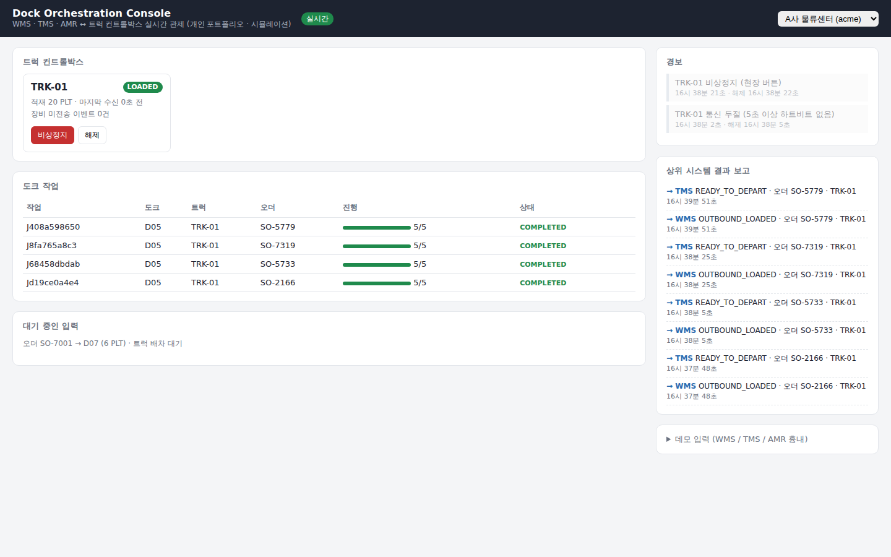

# dock-orchestrator

> **개인 포트폴리오 프로젝트입니다. 실제 고객사·장비가 아닌 시뮬레이션 기반으로 동작합니다.**
> 목적: 장비 제어부터 클라우드 관제, 상위 시스템 연동까지 한 사람이 전 구간을 설계·구현할 수 있음을 보여주는 것.

물류센터 **도크(창고와 트럭이 만나는 상하차 지점)** 를 자동화하는 소형 플랫폼입니다.
창고 관리 시스템(WMS)의 출고 오더와 운송 관리 시스템(TMS)의 배차를 합쳐 도크 작업을 만들고,
로봇(AMR)이 짐을 가져오면 트럭 적재함의 컨트롤박스에 적재 명령을 내린 뒤, 결과를 다시 상위 시스템에 보고합니다.



---

## 구성

```
[WMS 출고 오더] ─ JSON(A사) / JSON 박스단위(B사) ─┐
[TMS 배차]      ─ CSV ───────────────────────────┼─> 어댑터 ─> [오케스트레이터] ──MQTT──> [트럭 컨트롤박스 에이전트]
[AMR 도착]      ─ VDA 5050 단순화 JSON ───────────┘       │        ▲    cmd (QoS1)        상태머신 · 구동부(GPIO)
                                                          │        └─── evt / status ─── 아웃박스(SQLite)
                                        [WMS/TMS 결과 보고]  [경보 엔진]  [사용량 집계]
                                                          │
                                               WebSocket  ▼
                                                 [관제 화면 /dock]
```

| 영역 | 파일 | 내용 |
|---|---|---|
| 장비 | `agent/agent.py` | 명령 수신, 구동, 진행 이벤트, 현장 비상정지 버튼 |
| | `agent/statemachine.py` | IDLE · LOADING · LOADED · UNLOADING · ESTOP · FAULT 상태 전이 |
| | `agent/outbox.py` | 통신 단절 대비 이벤트 저장·재전송, 명령 중복 실행 방지 |
| | `agent/actuator.py` | 구동부 추상화 (PC 모의 / 라즈베리파이 GPIO) |
| 서버 | `server/orchestrator.py` | 오더·배차 매칭, 작업 상태, ACK 재전송, 경보, 결과 보고, 사용량 |
| | `server/adapters/` | 고객사별 WMS·TMS 형식을 공통 모델로 변환 |
| | `server/app.py` | REST API, WebSocket, MQTT 브리지 |
| 화면 | `server/static/` | 도크 관제 화면 (빌드 없는 순수 HTML/JS, 외부 CDN 없음) |
| 시험 | `sim/`, `tests/` | 상위 시스템·로봇 시뮬레이터, 단위 테스트 |

## 빠른 실행

**Docker**
```bash
docker compose up --build
# 관제 http://localhost:8080/dock
python -m sim.scenario --tenant acme --truck TRK-01 --dock 5     # 작업 1건 발생
```

**Docker 없이 (Python 3.11+)**
```bash
pip install -r requirements-dev.txt
./scripts/run_demo.sh
python -m sim.scenario --tenant acme --truck TRK-01 --dock 5
```

## 시연 시나리오

단축 명령: `./demo.sh start` · `job` · `job hanbit` · `cut` · `estop` · `resume` · `stop` (`./demo.sh help`)

| # | 할 일 | 보이는 것 |
|---|---|---|
| 1 | `sim.scenario` 실행 | 오더 → 배차 → 작업 생성 → AMR 도착 → 트럭 적재 진행 → 완료 → WMS·TMS 보고 |
| 2 | 적재 중 `kill -USR1 <트럭 pid>` (라즈베리파이라면 LAN 케이블 분리) | 5초 뒤 **통신 두절 경보**, 장비는 이벤트를 로컬에 저장 |
| 3 | 다시 `kill -USR1` (케이블 연결) | 쌓인 이벤트가 **순서대로 재전송**, 작업이 유실 없이 완료, 경보 자동 해제 |
| 4 | 적재 중 `kill -USR2` (보드의 비상정지 버튼) | 모터 즉시 정지, **치명 경보**, 작업 HALTED → 해제 후 **남은 수량만 재개** |
| 5 | 화면 우상단에서 B사 선택 | 박스 단위 WMS가 팔레트로 환산되어 같은 흐름으로 처리, A사 데이터와 분리 |


## 설계 결정

| 문서 | 요지 |
|---|---|
| [0001 MQTT 채택](docs/adr/0001-mqtt-over-http.md) | LTE 환경의 장비는 서버가 먼저 말을 걸 수 없다 → 상시 연결 + 발행/구독 |
| [0002 이벤트 무손실](docs/adr/0002-store-and-forward.md) | 장비에 먼저 저장하고 수신 확인 후 삭제, 재연결 시 순서대로 재전송 |
| [0003 멱등성](docs/adr/0003-idempotency.md) | 명령은 cmd_id, 이벤트는 evt_id로 중복을 무해하게 만든다 |
| [0004 어댑터 구조](docs/adr/0004-adapter-per-customer.md) | 고객사 형식 차이는 어댑터가 흡수, 코어는 공통 모델만 안다 |
| [0005 멀티테넌트·과금 근거](docs/adr/0005-tenancy-and-metering.md) | 모든 데이터에 tenant, 완료 작업 기준 사용량 집계 |

## 테스트

```bash
python -m pytest -q      # 18 passed
```
상태머신, 명령 중복, 통신 단절 후 순서 보장, 비상정지·재개, ACK 미수신 재전송, 하트비트 만료·복구,
고객사 데이터 분리, 중복 이벤트의 과금 이중 집계 방지.
GitHub Actions가 push마다 테스트와 Docker 빌드를 수행합니다 (`.github/workflows/ci.yml`).

## 한계와 다음 단계 (의도적으로 범위 밖)

- `GpioActuator`는 라즈베리파이 핀 기준으로 작성했으며 실보드에서 핀 배치 확인이 필요하다.
- 저장소는 SQLite. 다중 서버 운영 시 PostgreSQL + 메시지 큐로 교체한다.
- 인증은 연동 API의 고객사별 API Key만 구현. 관제 화면 로그인, MQTT TLS·장비 인증서는 미적용.
- WMS·TMS 결과 보고는 DB 기록까지. 실제 고객사 웹훅 호출과 재시도 큐가 다음 단계.
